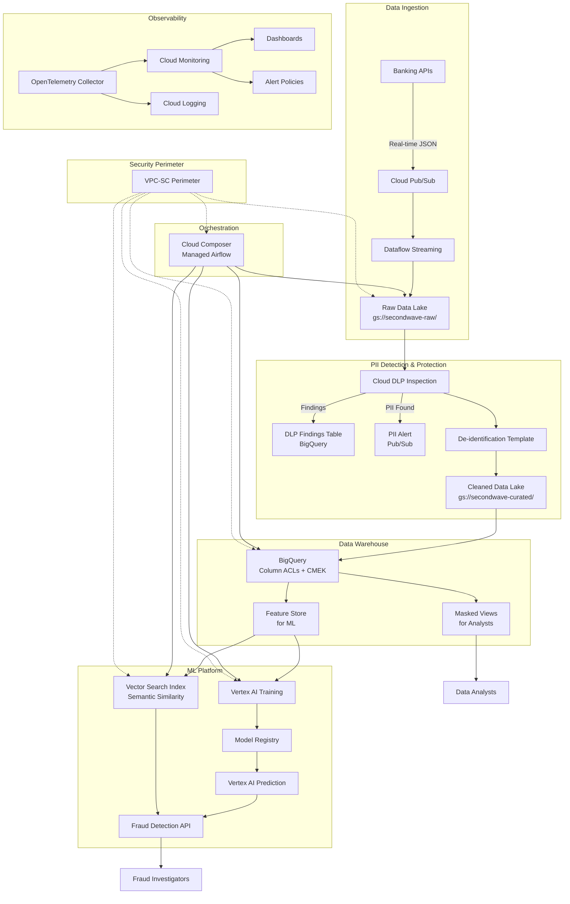

# SecondWave ML/AI Platform — Premium GCP Workload

> **ML/AI infrastructure reference design for fintech fraud detection under GDPR and PII constraints.**
>
> This is a reference architecture for a UK Platform Engineer contractor position targeting £600+/day GCP roles. It demonstrates Terraform with CMEK encryption, VPC-SC perimeters, column-level BigQuery security, Cloud DLP integration, and Vertex AI ML pipelines — all built for the **SecondWave** fraud detection scenario.

---

## Table of Contents

- [Scenario: SecondWave Fraud Detection](#scenario-secondwave-fraud-detection)
- [Architecture Overview](#architecture-overview)
- [Architecture Decisions](#architecture-decisions)
- [Data Flow: PII-Sensitive ML Pipeline](#data-flow-pii-sensitive-ml-pipeline)
- [Deployment Instructions](#deployment-instructions)
- [Production Safeguards](#production-safeguards)
- [Trade-offs and Alternatives](#trade-offs-and-alternatives)
- [Observability](#observability)
- [Disaster Recovery](#disaster-recovery)
- [Cost Governance](#cost-governance)
- [Repository Structure](#repository-structure)
- [Contributing](#contributing)

---

## Scenario: SecondWave Fraud Detection

**SecondWave** is a London-based fintech building a real-time fraud detection platform. The platform ingests 10M+ transactions/day from banking partners and applies ML models to identify fraudulent activity.

### Constraints

| Constraint | Implication |
|---|---|
| **GDPR Article 5, 25, 32** | PII data must be encrypted at rest (CMEK), access-controlled (column ACLs), and auditable |
| **UK data residency** | All PII must remain within UK borders (region: `europe-west2`, London) |
| **Financial regulations** (FCA, SEC 17a-4) | Transaction records retained for 7 years with immutable storage |
| **PCI-DSS** | Credit card data must be masked for non-authorised users |
| **5-person platform team** | Managed services over self-hosted; no Kubernetes expertise on the team |
| **£600+/day contractor rate** | Architecture must demonstrate the design, security and cost decisions expected of a senior engineer |

### Data Sources

- **Transaction events** — real-time JSON events from banking APIs
- **Customer profiles** — PII-rich customer data (name, address, SSN/NI, DOB)
- **Claim records** — insurance/dispute claims with supporting documents
- **Fraud reports** — investigator notes with sensitive personal data
- **External threat feeds** — IP reputation, device fingerprinting

---

## Architecture Overview

### High-Level Architecture



### Data Flow (PII-Aware)

```
Raw JSON ⟶ DLP Scan ⟶ De-identified Parquet ⟶ BigQuery (CMEK) ⟶ ML Features
   │               │
   │               └── PII findings → dlp_findings table (audit trail)
   │
   └── If PII > threshold → Pub/Sub alert → Data Engineering review
```

1. **Ingestion**: Transaction data arrives via Cloud Pub/Sub and is streamed to the raw data lake zone by Dataflow
2. **DLP Inspection**: Every file in the raw zone is automatically scanned by Cloud DLP for 150+ PII infoTypes
3. **De-identification**: PII is masked (e.g., `4111111111111111` → `****-****-****-1111`) using DLP de-identification templates
4. **Loading**: Cleaned data is loaded into BigQuery with CMEK encryption and column-level ACLs
5. **Feature Engineering**: ML engineers query masked views (no access to raw PII columns)
6. **Model Training**: Vertex AI Training uses features from BigQuery + Vector Search for semantic similarity
7. **Inference**: The fraud detection API scores transactions in <500ms, querying Vector Search for similar historical fraud cases

---

## Architecture Decisions

| ID | Decision | Rationale |
|---|---|---|
| ADR-001 | **Cloud Composer over self-hosted Airflow on GKE** | 5-person team can't maintain Airflow infra. Composer saves ~2 days/month of maintenance time. Full analysis: [ADR-001](docs/ADR/001-composer-over-self-hosted-airflow.md) |
| ADR-002 | **BigQuery column ACLs over view-only access** | Column ACLs protect all query patterns (SELECT *, CTAS, exports). Views only protect explicit queries through the view. Full analysis: [ADR-002](docs/ADR/002-column-level-security-over-view-only.md) |
| ADR-003 | **Vertex AI Vector Search over Elasticsearch** | Native Vertex AI integration, sub-10ms latency at 10M+ vectors, serverless scaling. 60% cost savings vs Elastic Cloud. Full analysis: [ADR-003](docs/ADR/003-vector-search-over-elasticsearch.md) |
| ADR-004 | **Data lake lifecycle tiering** | Automated tiering saves ~59% on storage costs (~$18,960/year at 100TB). Full analysis: [ADR-004](docs/ADR/004-data-lake-lifecycle-for-cost.md) |
| ADR-N/A | **CMEK over Google-managed encryption** | GDPR Article 32 requires "appropriate technical measures". CMEK gives key control, rotation logging, and cryptographic erasure capability |
| ADR-N/A | **Workload Identity Federation over SA keys** | No key management overhead, no key leakage risk, full audit trail of which workload accessed which resource |
| ADR-N/A | **VPC-SC perimeter** | Defense-in-depth: even if IAM is misconfigured, data cannot leave the perimeter |

---

## Deployment Instructions

### Prerequisites

- GCP project with billing enabled
- `gcloud` CLI installed and authenticated
- `terraform` >= 1.6.0
- `gsutil` for bucket operations

### Step 1: Bootstrap State Infrastructure

```bash
# Create the GCS state bucket and KMS key
chmod +x scripts/bootstrap-backend.sh
./scripts/bootstrap-backend.sh <PROJECT_ID> europe-west2
```

### Step 2: Enable Required APIs

```bash
gcloud services enable \
  bigquery.googleapis.com \
  storage.googleapis.com \
  composer.googleapis.com \
  aiplatform.googleapis.com \
  dlp.googleapis.com \
  cloudkms.googleapis.com \
  cloudresourcemanager.googleapis.com \
  iam.googleapis.com \
  --project=<PROJECT_ID>
```

### Step 3: Configure Variables

```bash
cp terraform.tfvars.example terraform.tfvars
# Edit terraform.tfvars with your project settings
```

### Step 4: Deploy

```bash
# Initialize Terraform (with backend configured)
terraform init

# Review the plan
terraform plan -out=tfplan

# Apply
terraform apply tfplan

# Seed the data lake folder structure
./scripts/seed-data-lake.sh <PROJECT_ID> dev
```

### Step 5: Verify Deployment

```bash
# Check outputs
terraform output

# Verify BigQuery datasets
bq ls --project_id=<PROJECT_ID>

# Verify data lake buckets
gsutil ls -p <PROJECT_ID>

# Check DLP templates
gcloud dlp templates list --project=<PROJECT_ID>
```

---

## Production Safeguards

| Layer | Safeguard | Implementation |
|---|---|---|
| **Encryption** | CMEK for all data-at-rest | KMS keys for BigQuery, Storage, Composer, Vertex AI. Key rotation via KMS version management |
| **Network** | No public IPs | Composer private IP, Vertex AI private networking, Cloud Run VPC egress only |
| **Identity** | Workload Identity Federation | No service account keys. OIDC tokens from GitHub Actions, ML workloads |
| **Perimeter** | VPC-SC | All ML/AI services restricted to VPC network. Data exfiltration prevention |
| **Access** | Column-level ACLs | PII columns tagged via Data Catalog. Only data-engineering group can read raw values |
| **Masking** | Row-level security | Analysts see masked PII. Row-level filter controls visibility per row |
| **Inspection** | Cloud DLP | Automated PII scanning on every new file. 150+ infoTypes. Findings logged for audit |
| **Compliance** | Immutable storage | Retention policy locked on raw zone. 7-year retention for financial regulations |
| **Backup** | Object versioning | All data lake zones (except transient) have versioning for accidental deletion recovery |
| **Scanning** | Checkov + TFLint | Pre-commit hooks and CI pipeline scan all Terraform for security misconfigurations |
| **Cost** | Lifecycle tiering | Automated transition to Nearline/Coldline/Archive. Transient zone auto-deletes after 7 days |
| **Observability** | Alert policies | DAG failure rate > 5%, slot usage > 80%, DLP scan failure, bucket growth anomaly |

---

## Trade-offs and Alternatives

| Decision | Alternative Considered | Why Not |
|---|---|---|
| Cloud Composer | Self-hosted Airflow on GKE | Team too small to maintain Airflow infra. Composer premium ($500/month) < engineer time savings |
| BigQuery column ACLs | View-only access | Views don't protect SELECT * or CTAS. Column ACLs cover all access patterns |
| Vertex AI Vector Search | Elasticsearch ANN | Elasticsearch at 10M 768-dim vectors needs 30GB+ heap, $1,800/month. Vector Search: $800/month |
| CMEK | Google-managed encryption | GDPR Article 32 requires key control. CMEK enables cryptographic erasure |
| Workload Identity | Service account keys | Key rotation overhead, leakage risk. WIF eliminates both |
| VPC-SC | IAM-only | IAM misconfigurations happen. VPC-SC is defense-in-depth |
| Data lake zones per environment | Single shared bucket | Multi-tenancy risk. Separate buckets per environment prevent cross-env data access |
| DLP | Manual PII scanning | 150+ infoTypes with zero maintenance. Manual regex scanning would require constant updates |

---

## Observability

### Key Metrics

| Metric | Source | Alert Threshold |
|---|---|---|
| DAG success/failure rate | Cloud Composer | Failure > 5% over 5 minutes |
| BigQuery slot utilization | BigQuery | Usage > 80% over 1 hour |
| DLP scan status | Cloud DLP | Any failure |
| Data lake growth | Cloud Storage | > 50GB/hour anomaly |
| Vector Search latency | Vertex AI | P99 > 50ms |

### Dashboards

The Cloud Monitoring dashboard (`observability/ml-dashboard.json`) provides:
- Airflow DAG run rates (success vs. failure)
- BigQuery slot utilization (used vs. assigned)
- Vertex AI training job states (queued/running/succeeded/failed)
- Data lake storage by zone (raw/curated/consumption)
- DLP inspection findings by infoType
- Vector Search query latency (P50/P95/P99)
- Daily cost by GCP service

### Alert Policies

Alert policies (`observability/alert-policies.json`) are deployed with Terraform:
- **Critical**: DAG failure rate > 5%, DLP scan failure
- **Warning**: BigQuery slots > 80%, bucket growth anomaly
- **Info**: Vector Search index build failure

---

## Disaster Recovery

### RTO / RPO Targets

| Component | RTO | RPO | Strategy |
|---|---|---|---|
| BigQuery | 4h | 1h | Time travel (7d), daily snapshots |
| Data Lake | 2h | 1h | Object versioning, cross-region DR (planned) |
| Composer | 4h | 1h | Terraform re-create, GCS versioned DAGs |
| Vertex AI | 2h | N/A | Terraform re-create |
| Vector Search | 4h | 6h | Weekly index export to GCS |

### Runbooks

- [BigQuery Dataset Restore](docs/runbooks/bigquery-dataset-restore.md) — Time travel and snapshot recovery
- [Composer DAG Failure](docs/runbooks/composer-dag-failure.md) — Diagnostics and recovery from DAG failures
- [Data Pipeline DR](docs/runbooks/data-pipeline-dr.md) — Full platform disaster recovery

---

## Cost Governance

### Estimated Monthly Cost (100TB steady state, 10M vectors)

| Component | Estimated Monthly Cost |
|---|---|
| Cloud Storage (with tiering) | ~$1,080 |
| BigQuery (500 slots flat rate) | ~$2,000 |
| Cloud Composer | ~$800 |
| Vertex AI Workbench (2 instances) | ~$400 |
| Vector Search | ~$200 |
| Cloud DLP | ~$300 |
| Networking (NAT, VPC) | ~$200 |
| **Total** | **~$4,980** |

### Cost Optimization Measures

1. **Lifecycle tiering**: Saves ~59% on storage costs (see ADR-004)
2. **Idle shutdown**: Vertex AI Workbench instances shut down after 60-120 minutes of inactivity
3. **Slot autoscaling**: BigQuery flex slots scale with demand; baseline is flat-rate
4. **Transient zone**: Auto-deletes processing artifacts after 7 days
5. **Infracost**: CI pipeline estimates cost impact of every PR (`.infracost.yml`)

### Resource Labeling

All resources are labelled with:
- `application: secondwave-fraud-detection`
- `environment: dev|staging|prod`
- `cost-center: ml-platform`
- `managed-by: terraform`
- `data-classification: pii-sensitive`

This enables cost breakdown and chargeback by environment and team.

---

## Repository Structure

```
gcp/premium-workload/
├── main.tf                          # Root module — orchestrates all modules
├── variables.tf                     # All Terraform variables with defaults
├── outputs.tf                       # Root module outputs
├── versions.tf                      # Provider constraints, backend config
├── terraform.tfvars.example         # Example variable values
│
├── modules/
│   ├── bigquery/                    # BigQuery datasets with CMEK + column ACLs
│   ├── data-lake/                   # Cloud Storage buckets with lifecycle tiering
│   ├── composer/                    # Cloud Composer (managed Airflow)
│   ├── vertex-ai/                   # Vertex AI Workbench instances
│   ├── vector-search/               # Vertex AI Vector Search indexes
│   ├── dlp/                         # Cloud DLP inspection + de-identification
│   └── workload-identity/           # Workload Identity Federation pools
│
├── .github/workflows/
│   ├── ml-platform-deploy.yml       # Terraform deploy with OIDC auth
│   └── dlp-scan.yml                 # On-demand DLP inspection
│
├── scripts/
│   ├── bootstrap-backend.sh         # Creates state bucket + KMS key
│   └── seed-data-lake.sh            # Initial folder structure in data lake
│
├── docs/
│   ├── ADR/                         # Architecture Decision Records
│   │   ├── 001-composer-over-self-hosted-airflow.md
│   │   ├── 002-column-level-security-over-view-only.md
│   │   ├── 003-vector-search-over-elasticsearch.md
│   │   └── 004-data-lake-lifecycle-for-cost.md
│   └── runbooks/                    # Operational runbooks
│       ├── bigquery-dataset-restore.md
│       ├── composer-dag-failure.md
│       └── data-pipeline-dr.md
│
├── observability/
│   ├── otel-collector.yaml          # OpenTelemetry collector config
│   ├── ml-dashboard.json            # Cloud Monitoring dashboard
│   └── alert-policies.json          # Cloud Monitoring alert policies
│
├── tests/
│   ├── bigquery_test.go             # Terratest for BigQuery module
│   └── data_lake_test.go            # Terratest for Data Lake module
│
├── .tflint.hcl                      # TFLint configuration
├── .checkov.yml                     # Checkov security scanner config
├── .pre-commit-config.yaml          # Pre-commit hook configuration
├── .infracost.yml                   # Cost estimation config
├── .tool-versions                   # ASDF tool version pinning
├── .gitignore
├── .editorconfig
└── README.md
```

---

## Contributing

1. Install pre-commit: `pip install pre-commit && pre-commit install`
2. Create a feature branch: `git checkout -b feat/your-feature`
3. Make changes, run `pre-commit run --all-files`
4. Submit a PR — CI runs `terraform plan`, Checkov security scan, Infracost estimate, and Terratest validation

### PR Checklist

- [ ] Terraform fmt check passes
- [ ] TFLint reports no errors
- [ ] Checkov reports no CKV_GCP_* failures
- [ ] Infracost estimate shows acceptable cost impact
- [ ] Updated relevant ADRs if architectural decisions changed
- [ ] Updated runbooks if operational procedures changed
- [ ] Added Terratest coverage for new modules

---

*Built for a UK Platform Engineer contractor portfolio — demonstrating GCP ML/AI infrastructure with security, compliance, and cost governance built in from day one.*
